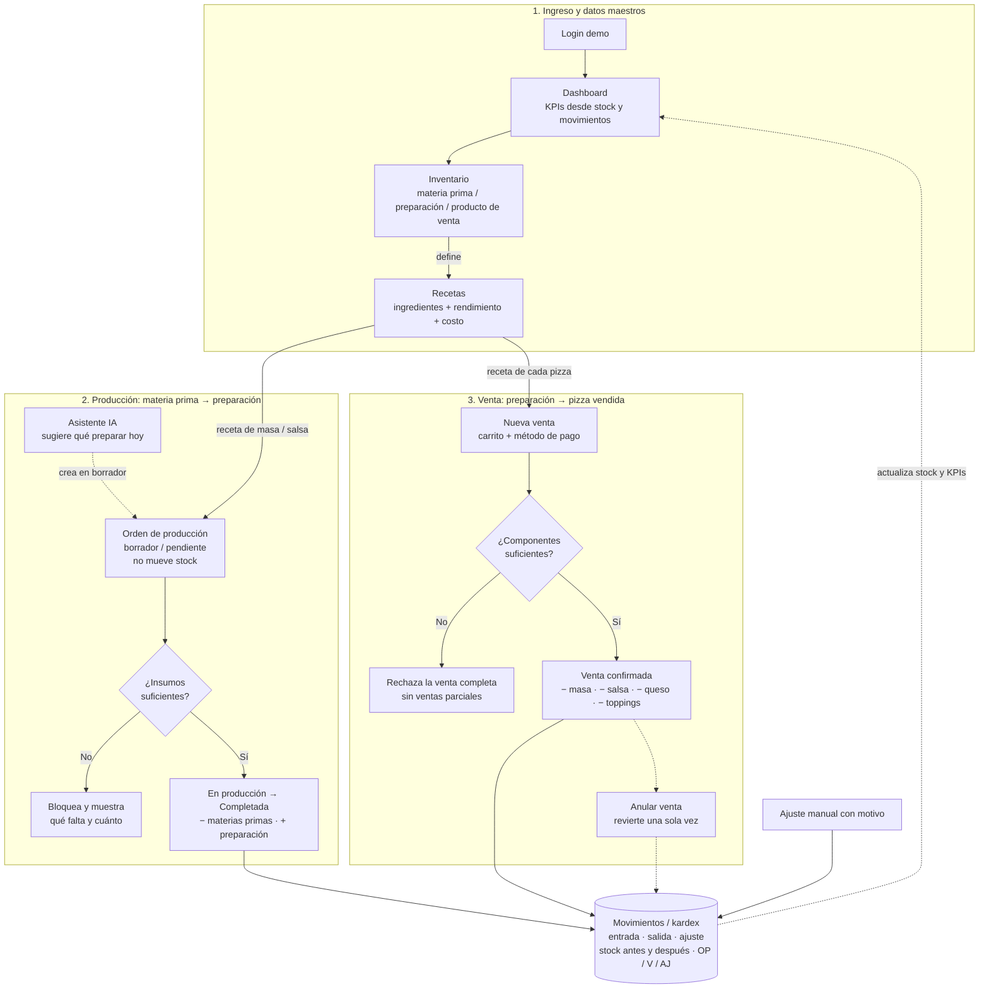

# Synthex Kitchen

**Primera experiencia de manufactura integrada al módulo de inventario de SYNTHEX.**
Caso de uso: *Forno Pizza*, una pizzería que transforma materias primas en preparaciones (masa, salsa) y estas en pizzas que vende.

> Desafío técnico · Product Owner Especialista en Inventario

| Entregable | Enlace |
| --- | --- |
| Demo funcional | `<!-- PEGAR AQUÍ EL LINK PUBLICADO DE LOVABLE -->` |
| Video (máx. 8 min) | `<!-- PEGAR AQUÍ EL LINK DEL VIDEO -->` |
| Flujo del aplicativo | [Diagrama en este README](#5-flujo-del-aplicativo) · [archivo de Excalidraw](docs/flujo-synthex-kitchen.excalidraw) |
| Prompt usado para construir con IA | [`docs/PROMPT_ORIGINAL.md`](docs/PROMPT_ORIGINAL.md) |

**Para probar el demo:** en el login presiona **Ingresar** (no valida credenciales). Si los datos quedaron modificados por otra persona, ve a *Configuración → Restablecer datos demo*.

---

## Contenido

1. [El problema y a quién le resuelvo](#1-el-problema-y-a-quién-le-resuelvo)
2. [Supuestos de negocio](#2-supuestos-de-negocio)
3. [Alcance de la primera versión](#3-alcance-de-la-primera-versión)
4. [Cómo se conecta la manufactura con el inventario](#4-cómo-se-conecta-la-manufactura-con-el-inventario)
5. [Flujo del aplicativo](#5-flujo-del-aplicativo)
6. [Módulos](#6-módulos)
7. [Reglas de negocio](#7-reglas-de-negocio)
8. [Arquitectura y modelo de datos](#8-arquitectura-y-modelo-de-datos)
9. [Uso de IA](#9-uso-de-ia)
10. [Recorrido sugerido del demo](#10-recorrido-sugerido-del-demo)
11. [Ejecutar localmente](#11-ejecutar-localmente)
12. [Estructura del repositorio](#12-estructura-del-repositorio)

---

## 1. El problema y a quién le resuelvo

Muchos clientes de SYNTHEX no solo compran y venden: **transforman**. Hoy llevan esa transformación en hojas de cálculo o cuadernos, por fuera del sistema. Eso genera tres dolores:

- **El inventario no cuadra.** El sistema sabe cuánta harina se compró, pero no cuánta se convirtió en masa ni cuánta masa salió en pizzas vendidas.
- **No conocen su costo real.** Sin una receta en el sistema, no saben cuánto les cuesta producir cada referencia ni su margen.
- **Se enteran tarde de los faltantes.** Descubren que no alcanza el queso cuando ya están produciendo o vendiendo.

**Usuario principal:** el administrador o dueño de un negocio pequeño de alimentos (en el demo, *Laura Gómez*, administradora de Forno Pizza). Necesita saber qué tiene, qué puede producir con eso, cuánto le cuesta y qué debe reponer, sin aprender un sistema de manufactura complejo.

Elegí una pizzería porque tiene, en pocos productos, los tres niveles que aparecen en casi cualquier manufactura liviana:

```
Materia prima  ──(orden de producción)──▶  Preparación  ──(venta)──▶  Producto de venta
harina, queso, tomate…                     masa, salsa                Pizza Margarita, Pepperoni…
```

## 2. Supuestos de negocio

El reto permite asumir características del negocio siempre que se hagan explícitas. Estas son las mías:

| # | Supuesto | Por qué |
| --- | --- | --- |
| 1 | Un solo negocio y una sola bodega. | Mantiene el foco en la relación producción ↔ inventario. |
| 2 | Cada producto tiene **tres categorías posibles**: materia prima, preparación o producto de venta. | Es el mínimo para modelar una transformación de dos etapas. |
| 3 | Cada producto fabricado tiene **una sola receta** (lista de materiales), con un **rendimiento** (ej. 1 kg de harina + 20 ml de aceite → 4 bases de masa). | Las versiones de receta pueden esperar a una segunda fase. |
| 4 | Las **preparaciones se producen por lotes** mediante órdenes de producción y quedan en inventario. | Así trabaja una cocina: la masa y la salsa se preparan antes del servicio. |
| 5 | Las **pizzas se arman al momento de la venta**: no tienen stock propio; al confirmar la venta se descuentan sus componentes. | Evita una orden de producción por cada pizza vendida, que nadie haría en la vida real. |
| 6 | Si una pizza usa *salsa preparada*, se descuenta la salsa, **no** sus ingredientes originales. Las materias primas solo se descuentan cuando se ejecuta la orden que produce la preparación. | Evita el doble descuento de insumos. |
| 7 | Unidades de medida base: kg, l y und. Las recetas pueden expresarse en g o ml y se convierten automáticamente. | Las recetas se escriben en gramos; el inventario se compra en kilos. |
| 8 | El costo es un **costo unitario estándar** por producto, y el costo de una receta es la suma de sus ingredientes. | Suficiente para una V1; el costo promedio ponderado es una mejora futura. |
| 9 | La producción teórica es igual a la real (sin mermas). | Ver "Qué dejé fuera". |
| 10 | Montos en pesos colombianos (COP), sin autenticación ni roles. | Es un demo; el foco está en la lógica de inventario. |

## 3. Alcance de la primera versión

### Qué incluí

- **Inventario** con tres categorías, SKU, stock mínimo, costo y estados automáticos (Óptimo, Stock bajo, Agotado).
- **Recetas** con ingredientes, rendimiento, conversión de unidades, costo calculado y verificación de disponibilidad para producir una cantidad.
- **Órdenes de producción** con ciclo de estados (Borrador → Pendiente → En producción → Completada / Cancelada), validación de insumos y movimientos automáticos.
- **Ventas** que descuentan los componentes de cada pizza según su receta, con anulación que revierte el inventario una sola vez.
- **Movimientos (kardex)**: libro inmutable de entradas, salidas y ajustes con stock antes y después y documento de referencia.
- **Asistente de producción con IA** que sugiere qué preparar hoy y valida cada sugerencia con las reglas de inventario antes de permitir crear la orden.
- **Dashboard** con indicadores calculados desde los datos reales: valor del inventario, referencias activas, stock bajo, órdenes pendientes, ventas del día y de los últimos 7 días.
- **Consistencia transaccional**: todas las operaciones que mueven stock se ejecutan en la base de datos en una sola transacción.

### Qué dejé fuera (y por qué)

| Fuera de la V1 | Razón | Siguiente paso propuesto |
| --- | --- | --- |
| Compras y proveedores | El reto se centra en la transformación. Las entradas se registran como ajuste manual con motivo (ej. "Compra a proveedor"). | Orden de compra que genere entradas y sugiera reposición. |
| Mermas y rendimiento real vs. teórico | Requiere capturar datos en piso que un negocio pequeño aún no tiene. | Registrar la cantidad real producida al completar la orden y mostrar la desviación. |
| Costo promedio ponderado | El costo estándar basta para validar el concepto. | Recalcular el costo en cada entrada. |
| Lotes y fechas de vencimiento | Importante en alimentos, pero agrega complejidad en toda la experiencia. | Lote por orden de producción y alertas FEFO. |
| Multibodega, versiones de receta, planificación (MRP) | Corresponden a negocios más grandes que el usuario objetivo. | Evaluar según demanda de clientes. |
| Autenticación y roles | No aporta a validar el flujo de manufactura. | Roles de cocina, administración y caja. |

## 4. Cómo se conecta la manufactura con el inventario

Es la pregunta central del reto. **La manufactura no tiene un inventario propio**: usa los mismos productos y existencias del módulo de inventario, y cada operación deja rastro en el mismo libro de movimientos.

| Evento | Efecto en el stock | Movimiento registrado |
| --- | --- | --- |
| Crear orden de producción (Borrador / Pendiente) | Ninguno | — |
| Iniciar orden (En producción) | Ninguno; solo valida que alcancen los insumos | — |
| **Completar orden** | − ingredientes (materias primas)<br>+ producto resultante (preparación) | Salidas y entrada con referencia `OP-xxxx` |
| Guardar venta en borrador | Ninguno | — |
| **Confirmar venta** | − componentes de la receta de cada pizza (masa, salsa preparada, queso, toppings) | Salidas con referencia `V-xxxxx` |
| Anular venta confirmada | + devuelve exactamente lo que se descontó | Entradas tipo anulación con la misma referencia |
| Ajuste manual / edición de stock | Suma, resta o fija el stock | Entrada, salida o ajuste con referencia `AJ-xxxx` y motivo |

Ejemplo con datos del demo: completar una orden de **8 bases de masa** consume 2 kg de harina y 40 ml de aceite, y suma 8 unidades de masa. Vender **una Pizza Pepperoni** descuenta 1 base de masa, 150 g de queso, 100 g de salsa preparada y 50 g de pepperoni.

## 5. Flujo del aplicativo



> **Versión visual en Excalidraw:** [`docs/flujo-synthex-kitchen.excalidraw`](docs/flujo-synthex-kitchen.excalidraw). Descárgalo y ábrelo en [excalidraw.com](https://excalidraw.com) (menú → *Abrir*). Incluye además la capa de arquitectura que garantiza la consistencia del inventario. Se genera con [`docs/generar_flujo.py`](docs/generar_flujo.py).

## 6. Módulos

| Módulo | Qué permite |
| --- | --- |
| **Login** | Pantalla de ingreso visual. No valida credenciales. |
| **Dashboard** | KPIs, gráfico de ventas de los últimos 7 días, inventario por categoría, alertas de reposición y acceso al asistente de IA. |
| **Inventario** | Crear, consultar, editar, desactivar y eliminar productos. Filtros por categoría, estado y nivel de stock. Búsqueda por nombre o SKU. Historial de movimientos por producto. |
| **Recetas** | Definir ingredientes, cantidades (con unidades g/kg, ml/l, und), rendimiento y costo. Consultar si hay material suficiente para producir una cantidad y cuánto falta. |
| **Producción** | Crear órdenes, ver el desglose de insumos requeridos vs. disponibles, iniciar, completar o cancelar. Detalle con insumos consumidos y resultado producido. Incluye el **Asistente de producción IA** (ver sección 9). |
| **Ventas** | Carrito de pizzas, método de pago (efectivo, tarjeta, transferencia), guardar borrador, confirmar, anular y eliminar borradores. |
| **Movimientos** | Libro de inventario filtrable por producto, tipo y fecha. Ajustes manuales con confirmación y motivo obligatorio. |

Todas las acciones de crear, editar y consultar se abren en paneles laterales (*drawers*) para no perder el contexto del módulo.

## 7. Reglas de negocio

Cada regla se valida dos veces: en la interfaz, para dar retroalimentación inmediata, y en la base de datos, que es la fuente de verdad.

**Producción**
1. Crear una orden en borrador o pendiente no modifica existencias.
2. Antes de iniciar o completar una orden se valida que todos los ingredientes tengan stock suficiente; si no, se muestra qué falta y cuánto.
3. Al completar se descuentan los ingredientes y se suma el producto resultante según el rendimiento de la receta.
4. Una orden completada no puede ejecutarse de nuevo ni descontar inventario dos veces.
5. Solo se eliminan órdenes en borrador; las pendientes se cancelan y las completadas se conservan como historial.

**Ventas**
6. Una venta solo se confirma si alcanzan **todos** los componentes de **todas** las pizzas del carrito; si falta uno, no se aplica ningún cambio (sin ventas parciales).
7. Solo se venden productos que tienen receta.
8. Las ventas confirmadas no se eliminan: se anulan, y la anulación revierte sus movimientos una sola vez.

**Inventario y recetas**
9. El stock nunca puede quedar negativo (restricción `check (stock >= 0)` en la tabla).
10. No se puede eliminar un producto con movimientos, recetas o ventas asociadas; el sistema explica el motivo y ofrece desactivarlo.
11. El SKU es único. Las recetas no aceptan cantidades nulas o negativas, ingredientes duplicados ni un producto como ingrediente de sí mismo.
12. Los movimientos generados por operaciones confirmadas no se editan ni se eliminan.

## 8. Arquitectura y modelo de datos

### Stack

| Capa | Tecnología |
| --- | --- |
| Frontend | React 19, TanStack Start / Router, Tailwind CSS 4, shadcn/ui, Recharts |
| Datos | PostgreSQL en Supabase (Lovable Cloud), consumido mediante funciones RPC |
| IA | Lovable AI Gateway + Vercel AI SDK (respuesta estructurada), desde funciones de servidor |
| Construcción | Lovable (IA) + Vite |
| Pruebas | Vitest + Testing Library |

### Cómo se garantiza la consistencia

1. La interfaz llama una acción de [`src/lib/store.ts`](src/lib/store.ts), que valida y actualiza la pantalla de inmediato (actualización optimista).
2. La acción invoca una función `sk_*` de PostgreSQL ([`drizzle/migrations/0000_synthex_kitchen_schema.sql`](drizzle/migrations/0000_synthex_kitchen_schema.sql)). Las tablas son de **solo lectura** para el cliente: toda escritura pasa por estas funciones.
3. Cada función corre en **una sola transacción**: bloquea las filas de los productos (`for update`), vuelve a validar el stock y registra los movimientos. Si algo falla, no se aplica nada.
4. Un **índice único** sobre `movements (ref_type, ref_id, product_id)` impide que la misma orden o venta descuente inventario dos veces, aunque el usuario haga doble clic o tenga dos pestañas abiertas.
5. Al terminar, `sk_get_state` recarga el estado real desde la base de datos.

### Modelo de datos

| Tabla | Contenido | Relaciones |
| --- | --- | --- |
| `products` | Materias primas, preparaciones y productos de venta: SKU, unidad, stock, mínimo, costo, precio, estado. | — |
| `recipes` | Receta de un producto y su rendimiento. | 1 receta por producto (`product_id` único) |
| `recipe_ingredients` | Ingredientes de la receta con cantidad y unidad. | `recipes` × `products` |
| `production_orders` | Órdenes `OP-xxxx`: receta, cantidad, estado, insumos consumidos y cantidad producida. | `recipes` |
| `sales` / `sale_items` | Ventas `V-xxxxx` con método de pago, estado, total y detalle con el precio usado. | `products` |
| `movements` | Kardex: tipo, cantidad, stock antes y después, motivo y documento de referencia. | `products`; referencia a orden, venta o ajuste |

Funciones principales: `sk_save_product`, `sk_adjust`, `sk_save_recipe`, `sk_save_order`, `sk_set_order_status`, `sk_complete_order`, `sk_save_sale`, `sk_void_sale`, `sk_get_state` y `sk_reset_demo` (recarga los datos de ejemplo reproduciendo las operaciones con las mismas reglas de negocio, así que el historial inicial también es coherente).

## 9. Uso de IA

La IA se usó en dos frentes: para **construir** el demo y **dentro de la experiencia** del usuario.

### IA dentro de la experiencia: Asistente de producción

**Problema:** el administrador no sabe cuánta masa y salsa preparar para el servicio. Si prepara poco, no puede vender; si prepara de más, desperdicia.

**Qué hace:** desde *Producción → Sugerir con IA* (o la tarjeta del Dashboard), el asistente analiza:

- el stock y el mínimo de cada preparación;
- las recetas y el stock de las materias primas;
- el consumo diario promedio de los últimos 7 días, calculado a partir de los movimientos de venta;
- las órdenes de producción abiertas, para no sugerir duplicados.

Con eso propone órdenes de producción con cantidad, prioridad y la razón de cada sugerencia.

**Cómo se integra con el inventario sin romper sus reglas:**

1. El modelo responde en un formato estructurado (producto, cantidad, prioridad y razón), no en texto libre.
2. **Cada sugerencia se vuelve a validar** con las mismas reglas de la app: se calcula si alcanzan los insumos. Si no alcanzan, aparece marcada como *Faltan insumos* con lo que falta y no se puede crear.
3. La persona revisa, ajusta la cantidad y decide. Las órdenes se crean **en borrador** con la misma acción de siempre, así que **la IA nunca mueve inventario**.
4. La llamada al modelo ocurre en una función de servidor y la llave nunca llega al navegador. Si la IA falla, la app sigue funcionando normalmente.

| Pieza | Archivo |
| --- | --- |
| Conexión con Lovable AI Gateway (modelo `openai/gpt-6-astra`) | [`src/lib/ai-gateway.server.ts`](src/lib/ai-gateway.server.ts) |
| Función de servidor, instrucciones y esquema de respuesta | [`src/lib/ai-production.functions.ts`](src/lib/ai-production.functions.ts) |
| Panel del asistente, preparación del contexto y validación | [`src/components/ai-assistant.tsx`](src/components/ai-assistant.tsx) |

**Por qué esta funcionalidad y no otra:** ataca la decisión diaria más frecuente de un negocio que produce, que es *cuánto preparar*, y usa exactamente lo que construye la V1: recetas, stock y movimientos. La IA aporta el criterio y las reglas de negocio garantizan la consistencia.

### IA para construir

| Herramienta | Para qué | Por qué |
| --- | --- | --- |
| **Lovable** | Generar el aplicativo completo (interfaz, base de datos y funciones) a partir de un prompt de producto detallado, e iterar sobre él, incluido el asistente de producción. | Permite pasar de una especificación de negocio a un demo funcional en horas, que es lo que haría un PO para validar una idea con usuarios. |
| **Claude** | Revisar el código, documentar la lógica en este README, diseñar el diagrama de flujo y redactar el requerimiento del asistente de IA. | Para que la documentación refleje lo que el sistema hace realmente, verificado contra el código. |
| <!-- Agrega aquí otras herramientas de IA que usaste --> | | |

El prompt inicial está en [`docs/PROMPT_ORIGINAL.md`](docs/PROMPT_ORIGINAL.md). Muestra cómo traduje el problema en requerimientos concretos: datos de ejemplo, reglas de negocio numeradas, estados, validaciones y el flujo de punta a punta que debía poder demostrarse.

## 10. Recorrido sugerido del demo

1. **Dashboard:** revisa las alertas de reposición y las órdenes pendientes.
2. **Asistente IA:** pulsa *Sugerir producción*, revisa las sugerencias y crea una orden en borrador. Para ver más sugerencias, baja primero el stock de *Masa de pizza* en Inventario y pulsa *Regenerar*.
3. **Inventario:** observa el stock de *Masa de pizza* y *Harina de trigo*.
4. **Recetas:** abre *Masa de pizza* y consulta la disponibilidad para producir 20 unidades.
5. **Producción:** crea una orden de *Masa de pizza*, revisa el desglose de insumos, iníciala y complétala.
6. **Inventario:** confirma que bajó la harina y subió la masa.
7. **Ventas:** registra una venta con una Pizza Pepperoni y confírmala.
8. **Movimientos:** filtra por *Masa de pizza* y verifica la trazabilidad (`OP-…` y `V-…`, con stock antes y después).
9. **Prueba un límite:** intenta vender más pizzas de las que permite el queso disponible; la venta se rechaza completa y te dice qué falta.

## 11. Ejecutar localmente

Requisitos: Node.js 20 o superior.

```sh
git clone <URL-DE-ESTE-REPOSITORIO>
cd synthex-kitchen
npm install
npm run dev
```

El archivo `.env` apunta a la base de datos del demo en Lovable Cloud (Supabase) con la llave pública (*publishable key*). Para usar una base propia, crea un proyecto en Supabase, ejecuta [`drizzle/migrations/0000_synthex_kitchen_schema.sql`](drizzle/migrations/0000_synthex_kitchen_schema.sql) y reemplaza las variables `SUPABASE_*` y `VITE_SUPABASE_*`.

Otros comandos: `npm run build`, `npm run test`, `npm run lint`.

## 12. Estructura del repositorio

```
├── docs/
│   ├── flujo-synthex-kitchen.excalidraw  # Diagrama de flujo (Excalidraw)
│   ├── generar_flujo.py                  # Script que genera el .excalidraw
│   └── PROMPT_ORIGINAL.md                # Prompt usado en Lovable
├── drizzle/migrations/                   # Esquema SQL y funciones de negocio sk_*
├── src/
│   ├── lib/store.ts                      # Estado, cálculos (unidades, costos, requerimientos) y acciones
│   ├── lib/ai-*.ts                       # Asistente de producción IA (servidor)
│   ├── components/ai-assistant.tsx       # Panel del asistente IA
│   ├── routes/                           # Pantallas: login, dashboard y módulos /app/*
│   ├── components/                       # Kit de UI reutilizable (tablas, drawers, KPIs, badges)
│   └── integrations/supabase/            # Cliente de base de datos
└── README.md
```

---

Proyecto construido para el desafío técnico de Product Owner Especialista en Inventario. El escenario es ficticio.
